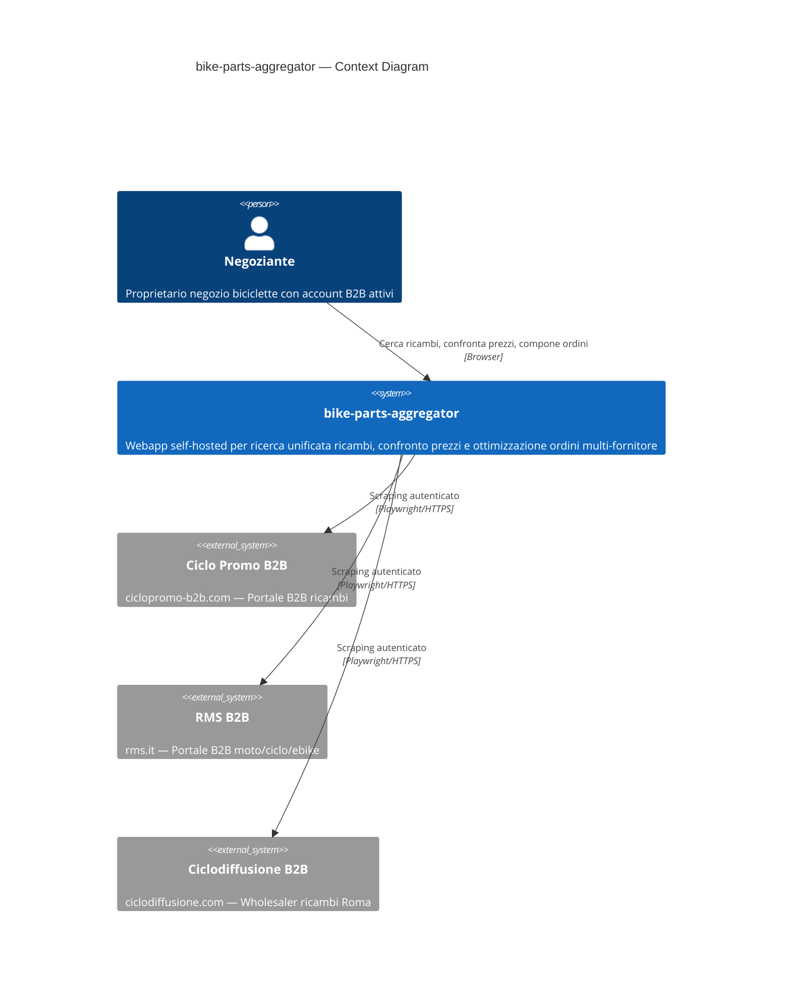

# 00 — Overview & Diagramma di Contesto

> Executive summary del sistema bike-parts-aggregator.
> Punto di ingresso per qualsiasi lettore esterno.

## Sommario Esecutivo

**bike-parts-aggregator** è una webapp self-hosted che consente a un singolo negoziante di biciclette italiano di cercare ricambi su più distributori B2B contemporaneamente, confrontare prezzi e disponibilità, e comporre ordini multi-fornitore ottimizzati secondo obiettivi configurabili (costo, tempo di consegna, numero fornitori, soglie free-shipping).

Il sistema gira interamente in locale su Docker Compose (Mac Studio M4 Max, 128 GB RAM, arm64). Non utilizza servizi cloud.

---

## Diagramma C4 — Livello 1 (Context)

### Flussi Principali

| # | Flusso | Descrizione |
|---|--------|-------------|
| 1 | **Ricerca unificata** | L'utente cerca un ricambio → il sistema interroga il catalogo locale (aggiornato via scraping notturno) → restituisce risultati aggregati da tutti i fornitori |
| 2 | **Confronto prezzi** | Risultati mostrati in tabella comparativa con prezzo, disponibilità, tempo consegna per fornitore |
| 3 | **Composizione ordine ottimizzato** | L'utente seleziona N ricambi → l'optimizer calcola la combinazione ottimale di ordini multi-fornitore secondo pesi configurabili → l'utente rivede e procede |

---

## Glossario di Dominio

| Termine | Definizione |
|---------|-------------|
| **SKU** | Stock Keeping Unit — codice identificativo di un prodotto presso un singolo fornitore |
| **EAN/GTIN** | European Article Number / Global Trade Item Number — codice a barre univoco internazionale (13 cifre). Non sempre presente nei cataloghi B2B |
| **canonical_product** | Rappresentazione unificata di un prodotto cross-fornitore, identificata da EAN (quando presente) o matching fuzzy |
| **supplier_listing** | Offerta specifica di un fornitore per un prodotto: prezzo, disponibilità, URL, SKU fornitore |
| **order_bundle** | Ordine composto ottimizzato: insieme di acquisti su uno o più fornitori che minimizzano la funzione obiettivo |
| **scraping_job** | Job asincrono di scraping: cattura dati da un fornitore (catalogo completo o ricerca specifica) |
| **correlation_id** | Identificatore univoco per tracciare una richiesta attraverso tutti i servizi (logging strutturato) |

---

## Tracciabilità Vincoli Architetturali

| # | Vincolo Non Negoziabile | Sezione(i) di Riferimento |
|---|------------------------|--------------------------|
| 1 | Docker Compose su Mac Studio M4 Max, zero cloud | s11 (Deployment & Ops) |
| 2 | Scraper in container isolati con Playwright | s05 (Scraping Architecture) |
| 3 | Job queue asincrona — scraping non blocca UI | s03 (Tech Stack — queue), s05 (scheduling) |
| 4 | Schema dati versionato con migration tool | s03 (Tech Stack — Alembic), s04 (Data Model) |
| 5 | Secrets via Docker secrets o age/sops, MAI plain .env | s09 (Secrets & Security) |
| 6 | Logging strutturato JSON con correlation ID | s10 (Observability) |
| 7 | Single-user, nessuna multi-tenancy | s08 (UI Architecture — auth model) |

---

## Alternative di Scope Scartate

| Alternativa | Motivazione dello Scarto |
|-------------|-------------------------|
| **SaaS multi-tenant** | L'utente è uno solo. Multi-tenancy aggiunge complessità (auth, isolamento dati, billing) senza beneficio. Il sistema è personale e gira sulla sua macchina. |
| **Mobile-first / PWA** | Il workflow primario è da desktop (PC in negozio/ufficio). Accesso da tablet in officina è un nice-to-have di fase 2, non il driver architetturale. |
| **Marketplace diretto** | L'obiettivo non è vendere ma acquistare. L'utente non rivende online; vuole ottimizzare i propri ordini B2B. |
| **Deploy cloud** | L'utente vuole privacy totale sui dati commerciali e credenziali B2B. Zero dipendenza da servizi cloud. Mac Studio ha risorse più che sufficienti. |

---

## Rischi Residui di Alto Livello

| Rischio | Impatto | Probabilità | Mitigazione |
|---------|---------|-------------|-------------|
| ToS fornitori vietano scraping | Progetto bloccato per fornitore | Media | Go/no-go gate in s02, procedura autorizzazione |
| Anti-bot bloccano Playwright | Scraping impossibile per fornitore | Media | Stealth tech, whitelist IP, fallback manuale (s05) |
| Redesign portale fornitore | Connettore rotto, manutenzione | Alta (nel tempo) | Pattern pluggable, test di regressione per connettore |
| Falsi positivi matching EAN | Ordini errati, dati corrotti | Bassa-Media | Validazione checksum, review manuale, soglie conservative (s04) |
| Mac Studio failure | Downtime totale | Bassa | Backup su NAS, recovery procedure (s11) |

---

## Open Questions sui Confini del Sistema

1. **Ordine diretto**: il sistema deve poter *effettuare* l'ordine sul sito fornitore (click-to-order) o solo *comporre* il carrello e linkare? → Fase 2 (s12)
2. **Storico prezzi**: il sistema deve tracciare l'andamento dei prezzi nel tempo? → Fase 2 (s12)
3. **Notifiche**: alert quando un prodotto scende sotto una soglia di prezzo? → Fase 2 (s12)
4. **Multi-utente futuro**: il sistema potrebbe essere usato da un dipendente? → No per fase 1 (vincolo single-user), rivalutare in fase 2

---

## Dipendenze

Questa sezione (**s01**) è il **fondamento** per tutte le altre sezioni (s02–s12). Ogni sezione successiva presuppone la lettura di questo documento come contesto.

| Sezione | Dipendenza da s01 |
|---------|-------------------|
| s02–s12 | Tutte dipendono da s01 come punto di ingresso e contesto di sistema |
