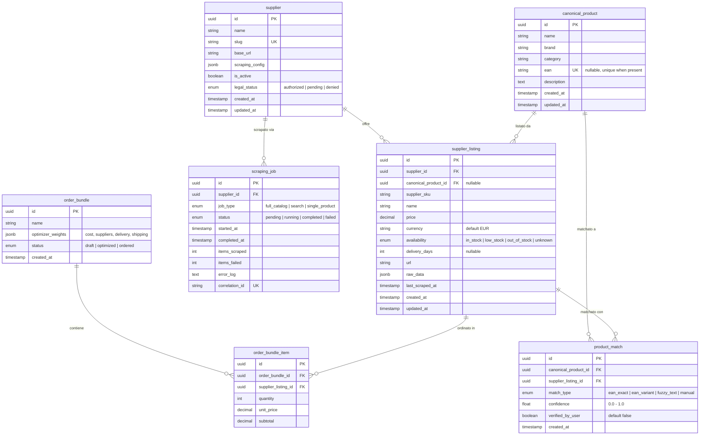

# 03 — Data Model & Normalizzazione EAN

> Schema dati canonico, policy di matching cross-fornitore, strategia fuzzy.

---

## Diagramma ER



### Vincoli Chiave

| Entità | Vincolo | Tipo |
|--------|---------|------|
| `supplier_listing` | `(supplier_id, supplier_sku)` | UNIQUE — un SKU è unico per fornitore |
| `canonical_product` | `ean` | UNIQUE (quando non NULL) |
| `product_match` | `(canonical_product_id, supplier_listing_id)` | UNIQUE — un match per coppia |
| `scraping_job` | `correlation_id` | UNIQUE — per tracciabilità log |

---

## Policy Normalizzazione EAN/GTIN

### Formato Canonico
- **EAN-13** è il formato di storage. EAN-8 viene zero-padded a 13 cifre (`12345678` → `0000012345678`).
- UPC-A (12 cifre) viene zero-padded a 13 cifre.

### Validazione
```
Algoritmo checksum mod-10:
1. Somma cifre in posizione dispari (1,3,5,...) × 1
2. Somma cifre in posizione pari (2,4,6,...) × 3
3. Checksum = (10 - (somma % 10)) % 10
4. Se checksum ≠ ultima cifra → EAN invalido → scartato con log
```

### Gestione Falsi Positivi

| Scenario | Rilevamento | Azione |
|----------|-------------|--------|
| Stesso EAN, stesso prodotto, fornitori diversi | Nomi simili (Levenshtein ≤ 0.3) | Auto-match (`ean_exact`, confidence 1.0) |
| Stesso EAN, nomi diversi (Levenshtein > 0.3) | Flag automatico | Coda review manuale (`ean_variant`, confidence 0.5) |
| EAN invalido (checksum fail) | Validazione al salvataggio | Scarta EAN, prodotto va a fuzzy matching |
| EAN assente | Campo NULL | Prodotto va a fuzzy matching pipeline |

### Deduplicazione
- Prima dello storage: normalizzare a 13 cifre, validare checksum.
- Upsert su `canonical_product.ean`: se EAN esiste, link al prodotto esistente.
- Se EAN non esiste: crea nuovo `canonical_product`, link `product_match`.

---

## Strategia Fuzzy Matching

Per prodotti **senza EAN** (o con EAN invalido).

### Campi Utilizzati
Concatenazione pesata: `brand` (peso 0.4) + `name` (peso 0.5) + `category` (peso 0.1)

### Algoritmo
PostgreSQL `pg_trgm` — trigram similarity:

```sql
SELECT cp.id, cp.name, cp.brand,
       similarity(cp.name || ' ' || cp.brand, 'Shimano Deore XT RD-M8100') AS sim
FROM canonical_product cp
WHERE (cp.name || ' ' || cp.brand) % 'Shimano Deore XT RD-M8100'
ORDER BY sim DESC
LIMIT 5;
```

### Soglie di Confidenza

| Range Similarity | Azione | match_type | confidence |
|-----------------|--------|------------|------------|
| ≥ 0.7 | Auto-match | `fuzzy_text` | similarity score |
| 0.4 – 0.7 | Suggerito per review manuale | `fuzzy_text` | similarity score |
| < 0.4 | Nessun match | — | — |

### Review Manuale
- UI con coda di match da verificare (fase 1: lista semplice)
- L'utente approva/rifiuta → `verified_by_user = true`
- Match rifiutati esclusi da future suggestioni

---

## Alternative Scartate

| Alternativa | Motivazione |
|-------------|-------------|
| **Schema denormalizzato** (una tabella per fornitore) | Query cross-fornitore impossibili senza JOIN. L'optimizer ha bisogno di confrontare prezzi da tutti i fornitori in una singola query. |
| **Document store (MongoDB)** | Join relazionali necessari per ottimizzazione. PostgreSQL FTS sufficiente per search. MongoDB aggiungerebbe complessità senza beneficio. |
| **Auto-increment ID** | UUID preferiti: non indovinabili (sicurezza URL), compatibili con potenziale multi-instance futuro, nessun conflitto in import batch. |
| **Embedding/LLM per matching** | Overkill per fase 1. Trigram similarity su brand+name è sufficiente per il 90% dei casi. Matching semantico avanzato in fase 2. |

---

## Rischi Residui

| Rischio | Impatto | Mitigazione |
|---------|---------|-------------|
| Falsi positivi EAN tra fornitori | Ordini duplicati o errati | Review manuale per match dubbi, soglia conservativa |
| Drift schema tra fornitori | Campi mancanti in raw_data | JSONB per raw_data, schema validation al parsing |
| Qualità fuzzy su nomi italiani | Match errati ("freno anteriore" vs "freno posteriore") | Includere category nel matching, feedback loop utente |
| UUID performance | Index più pesanti di auto-increment | Trascurabile a 100k righe, PostgreSQL gestisce bene UUID v4 |

---

## Open Questions

1. **Copertura EAN per fornitore**: quale percentuale di prodotti ha EAN? → Verificare durante supplier recon (s05)
2. **Soglia falsi positivi accettabile**: quanti false match l'utente è disposto a revisionare manualmente al giorno? → Proposta: max 20/giorno
3. **Varianti prodotto**: come gestire varianti (taglia, colore) dello stesso prodotto? → Proposta: stesso `canonical_product`, diversi `supplier_listing`

---

## Dipendenze

| Direzione | Sezione | Relazione |
|-----------|---------|-----------|
| **← s03** | Tech Stack | SQLAlchemy 2.0, PostgreSQL 16, Alembic determinano implementazione schema |
| **→ s06** | Search & Indexing | Indici FTS su `canonical_product.name`, `supplier_listing.name` |
| **→ s07** | Order Optimizer | L'optimizer legge `supplier_listing` (prezzo, disponibilità, delivery_days) |
| **→ s05** | Scraping Architecture | Gli scraper scrivono `supplier_listing` e `scraping_job` |
