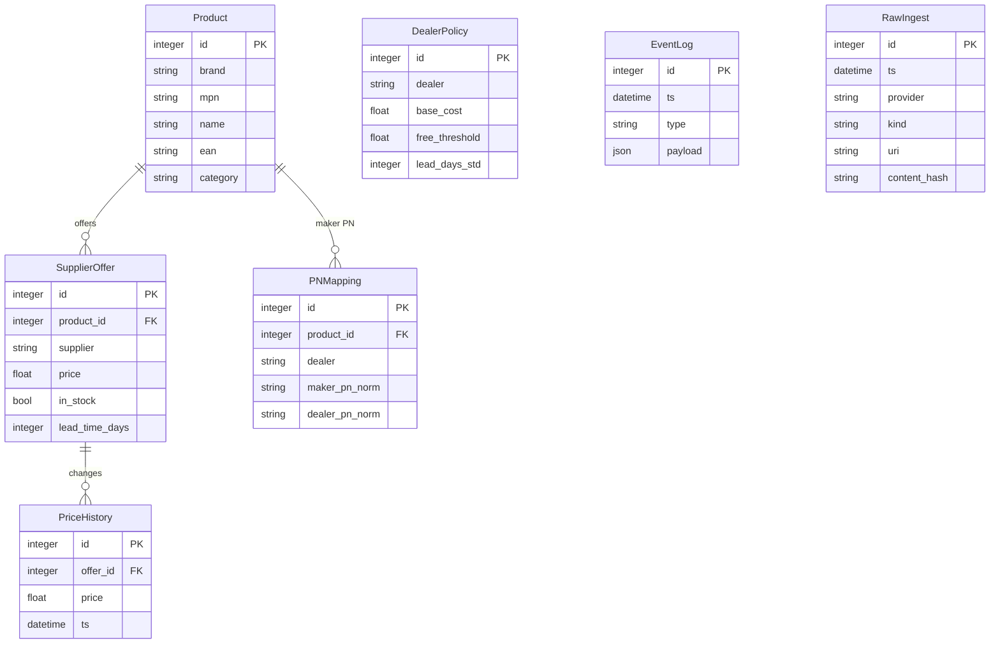

Runtime e Ambiente

Stack
- API/UI/CLI: FastAPI, Gradio, Typer; Python via uv
- Typi/lint/format: Pydantic v2, basedpyright, ruff
- DB: SQLite (WAL), SQLAlchemy 2.x
- ETL: pandas, pdfplumber (PDF), BeautifulSoup/httpx (web)
- Templating/PDF: Jinja2 + wkhtmltopdf/pdfkit (fallback HTML se assente)

Schema DB
- L’istanza SQLite unica (`app.db`) ospita i domini prodotti/offerte e i log di ingest; la figura seguente riassume colonne chiave e relazioni FK.

Boundary e Contratti
- Tutti i bordi esterni usano modelli tipizzati (vedi app/types.py). Nessun dict non tipizzato attraversa i bordi.
- L’ingest usa adapter provider che emettono ProductInput/OfferInput; l’upsert è idempotente e traccia lo storico prezzi.

Operatività
- Script: `make status`, `make test`, `make api`, `make ui`
- CI: vedi ARC-001 e workflow CI per l’ordine dei gate
- Systemd: deploy/bike-copilot.service; env tramite `/etc/default/bike-copilot-demo`

Configurazione (env)
- APP_DB_URL, APP_OUT_DIR, APP_PREFER_IN_STOCK, APP_SYNONYMS,
  APP_BASIC_USER/APP_BASIC_PASS, APP_VAT

Evidenze
- Conservare note di audit della `.venv` nella storia di TECH.md o nei session summary quando necessario.
