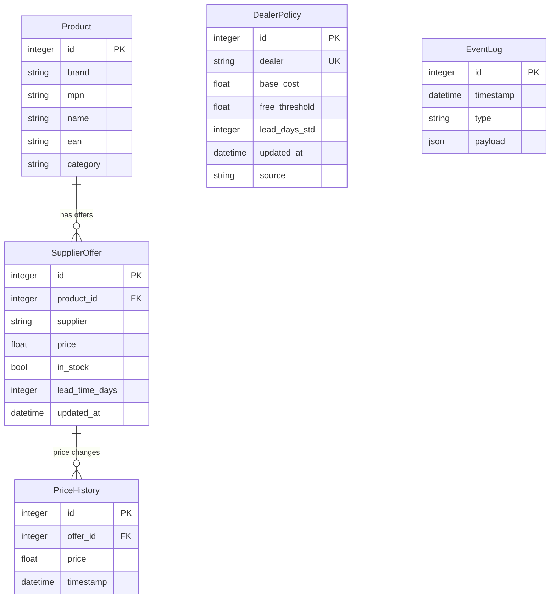

# TECH-010: Technology Stack

## Runtime Environment

| Component | Version | Notes |
|-----------|---------|-------|
| Python | 3.12+ | Required for modern typing features |
| uv | latest | Package and environment manager |
| SQLite | 3.35+ | WAL mode for concurrent access |

## Core Dependencies

### Web Framework

| Package | Version | Purpose |
|---------|---------|---------|
| fastapi | ^0.115 | REST API framework |
| uvicorn | ^0.32 | ASGI server |
| python-multipart | ^0.0.12 | Form data parsing |

### UI Layer

| Package | Version | Purpose |
|---------|---------|---------|
| jinja2 | ^3.1 | HTML templating |
| htmx | (CDN) | Progressive enhancement, AJAX |

### Database

| Package | Version | Purpose |
|---------|---------|---------|
| sqlalchemy | ^2.0 | ORM, async support |
| aiosqlite | ^0.20 | Async SQLite driver |

### Validation

| Package | Version | Purpose |
|---------|---------|---------|
| pydantic | ^2.9 | Data validation, OpenAPI schemas |
| pydantic-settings | ^2.6 | Environment configuration |

### Web Scraping

| Package | Version | Purpose |
|---------|---------|---------|
| playwright | ^1.48 | Browser automation for SPAs |
| httpx | ^0.27 | HTTP client for static sites |
| beautifulsoup4 | ^4.12 | HTML parsing |

### PDF Generation

| Package | Version | Purpose |
|---------|---------|---------|
| pdfkit | ^1.0 | wkhtmltopdf wrapper |
| wkhtmltopdf | (system) | HTML to PDF conversion |

### CLI

| Package | Version | Purpose |
|---------|---------|---------|
| typer | ^0.13 | Typed CLI framework |
| rich | ^13.9 | Terminal formatting |

### Development

| Package | Version | Purpose |
|---------|---------|---------|
| ruff | ^0.7 | Linting and formatting |
| basedpyright | ^1.20 | Type checking |
| pytest | ^8.3 | Testing framework |
| pytest-asyncio | ^0.24 | Async test support |

## Database Schema



## Configuration

### Environment Variables

| Variable | Required | Default | Description |
|----------|----------|---------|-------------|
| APP_DB_URL | No | sqlite:///data/bike.db | Database connection |
| APP_OUT_DIR | No | out/ | Output directory for quotes |
| APP_PREFER_IN_STOCK | No | true | Prioritize in-stock items |
| APP_VAT | No | 0.22 | VAT rate for quotes |
| DEALER_*_USERNAME | Yes | - | Dealer credentials |
| DEALER_*_PASSWORD | Yes | - | Dealer credentials |

### Database Configuration

```python
# SQLite WAL mode for concurrent reads
engine = create_async_engine(
    "sqlite+aiosqlite:///data/bike.db",
    connect_args={"check_same_thread": False},
    echo=False,
)

# Enable WAL mode
async with engine.begin() as conn:
    await conn.execute(text("PRAGMA journal_mode=WAL"))
    await conn.execute(text("PRAGMA busy_timeout=5000"))
```

## Type Boundaries

All external boundaries use typed Pydantic models:

| Boundary | Input Model | Output Model |
|----------|-------------|--------------|
| Search API | SearchRequest | list[ProductResult] |
| Optimize API | OptimizeRequest | OptimizationPlan |
| Quote API | QuoteRequest | QuoteResult |
| Crawl | - | ProductInput, OfferInput |

No untyped dicts cross service boundaries.

## Build and Run

```bash
# Install dependencies
uv sync

# Development server
uv run python -m app.cli api

# Production (with systemd)
# See deploy/bike-copilot.service

# Run tests
uv run pytest -v

# Type check
uv run basedpyright

# Lint and format
uv run ruff check --fix
uv run ruff format
```

## Playwright Setup

```bash
# Install browser binaries (first time)
uv run playwright install chromium

# Headless mode for crawling
browser = await playwright.chromium.launch(headless=True)
```

## Directory Structure

```
bike-copilot/
├── app/
│   ├── api.py           # FastAPI routes
│   ├── cli.py           # Typer commands
│   ├── models.py        # SQLAlchemy models
│   ├── search.py        # Search service
│   ├── optimizer.py     # Order optimizer
│   ├── quote.py         # Quote generation
│   ├── ingest.py        # Data ingestion
│   ├── adapters/        # Crawl adapters per dealer
│   ├── templates/       # Jinja2 templates
│   └── types.py         # Pydantic models
├── providers/
│   ├── dealers.yaml     # Dealer configuration
│   └── web-*.yaml       # Scraping selectors
├── data/
│   └── bike.db          # SQLite database
├── out/
│   └── quotes/          # Generated PDFs
└── tests/
    └── ...
```
